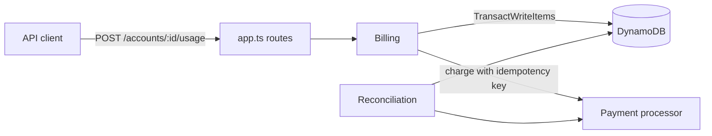

# usage-billing

A prepaid, usage-based billing service. Customers fund a balance, every API call is metered and priced on graduated monthly tiers, the balance recharges itself from a saved card when it runs low, and a reconciliation job checks that the money adds up.

It is a portfolio project modeled on public pricing for usage-based healthcare APIs (eligibility checks and claims). It has no users and no real money. The payment processor is an in-memory fake that behaves like Stripe where it matters: a request repeated with the same idempotency key returns the original charge.

TypeScript on Node 20, DynamoDB (DynamoDB Local in Docker for development and tests), Vitest.

## What it does

- **Meters each event exactly once.** Every usage event carries an idempotency key. A retry returns the original charge and costs nothing. The same key with a different body gets a 409.
- **Prices on graduated monthly tiers.** Each unit is priced by its position in the month. For eligibility checks, units 1-250 cost 30 cents and units 251-3,500 cost 15 cents, so 300 checks cost $82.50.
- **Skips non-billable events.** Test mode, payer result codes AAA42/AAA79/AAA80, and failed requests (HTTP 4xx/5xx) are recorded but free, and they don't use up tier-1 units.
- **Recharges automatically.** When the balance drops below the trigger ($10 by default), the saved card is charged ($25 by default, or the smallest multiple that lifts the balance back above the trigger). Only one recharge can run at a time per account.
- **Suspends at $0.** A declined recharge is recorded once, usage keeps working until the balance reaches zero, and then new usage gets HTTP 402. A new card or a manual top-up brings the account back.
- **Produces a monthly statement** with units per tier, price per tier, free events, total charged and payments received.
- **Reconciles.** Recomputes every account from its raw rows and from the payment processor and lists each mismatch with the account, the check, the expected value and the stored value.

## Pricing

| Product | Units per month: price per unit |
|---|---|
| eligibility | 1-250: 30c · 251-3,500: 15c · 3,501-10,000: 10c · 10,001+: 8c |
| claims | 1-500: 30c · 501-2,500: 20c · 2,501-10,000: 12c · 10,001+: 10c |

All money is stored as integer cents. Prices live in config (`src/pricing.ts`), not in the billing logic.

## How it works



Everything for one account lives under one partition key:

| Sort key | Holds |
|---|---|
| `META` | balance, status, recharge settings, recharge lease |
| `COUNT#<product>#<YYYY-MM>` | billable units used this month |
| `EVENT#<idempotencyKey>` | one row per usage event |
| `TOPUP#<paymentId>` | one row per payment credited to the balance |
| `RECHARGE_FAIL#<seq>` | a declined auto-recharge |

## Decisions and why

**One transaction per usage event.** The event row, the month's unit counter and the balance debit commit together or not at all. The event write is conditional on the key not existing, which makes retries safe. The counter write is conditional on the counter still holding the value that was read, because that value decides the tier price. If another request moved the counter first, the transaction is cancelled and the request reads again and retries. That way every unit gets its own position, even under concurrent requests.

**A lease for recharges.** The request that pushes the balance below the trigger tries to claim a 2-minute lease on the account row with a conditional write. Only one request can win it. The loser skips the recharge, because one is already happening.

**Crash-safe recharge.** Each recharge has a sequence number, and the processor call uses the idempotency key `recharge-<account>-<seq>`. The sequence only advances once the recharge is recorded. If the process dies after the card was charged but before the balance was credited, the next attempt reuses the same key and the processor returns the original charge instead of charging again. The top-up row is keyed by the payment id, so the same payment can never be credited twice.

**No automatic retries after a decline.** A declined recharge sets a flag and stops further attempts until the card changes or someone tops up by hand. Retrying on every request would produce a pile of declined charges.

**Balance can go slightly negative.** The request that crosses $0 completes, and the account is suspended right after. That keeps the debit path simple and matches how prepaid API billing usually works.

**Reconciliation recomputes instead of trusting.** It rebuilds the balance from top-ups and charges, the tier counters from the events, the month's charges from the price table, and checks every top-up against the processor in both directions. A bug that gets past the write path still shows up here.

## Run it

Needs Node 20+ and Docker.

```bash
npm install
npm run db:up     # DynamoDB Local on :8000
npm test          # 30 tests, including concurrency tests against DynamoDB Local
npm run demo      # the whole story in a few seconds
```

`npm run dev` starts a local HTTP server on :3000 (API key `local-dev-key` in the `x-api-key` header).

## API

| Method | Path | |
|---|---|---|
| POST | `/accounts` | create and fund an account |
| GET | `/accounts/:id` | balance, status, recharge settings |
| POST | `/accounts/:id/usage` | `{ idempotencyKey, product, testMode?, resultCode?, httpStatus? }` |
| GET | `/accounts/:id/statement?month=YYYY-MM` | monthly statement |
| POST | `/accounts/:id/topup` | `{ amountCents, idempotencyKey }` |
| POST | `/accounts/:id/payment-method` | switch cards (demo uses Stripe's test card ids) |
| POST | `/reconcile` | run reconciliation across all accounts |
| POST | `/admin/chaos` | demo only, off unless `ENABLE_CHAOS=1` |

Every route requires the `x-api-key` header.

## Scope and what's next

Not built: a real Stripe integration, contract or custom plans, invoices, multiple currencies, a UI. Reconciliation scans all accounts, which is fine at this size but would need an index or a stream at real volume. Next on the list: deploy to AWS (Lambda function URLs, DynamoDB on-demand, EventBridge for the daily reconciliation, Terraform) and swap the fake processor for Stripe test mode.
