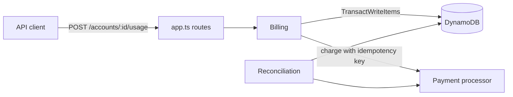

# meterline

A prepaid, usage-based billing service. Customers fund a balance, every API call is metered and priced on graduated monthly tiers, the balance recharges itself from a saved card when it runs low, and a reconciliation job checks that the money adds up.

It is a portfolio project modeled on public pricing for usage-based healthcare APIs (eligibility checks and claims). It has no users and no real money. The payment processor is an in-memory fake that behaves like Stripe where it matters: a request repeated with the same idempotency key returns the original charge.

TypeScript on Node 20, DynamoDB (DynamoDB Local in Docker for development and tests), Vitest.

## In plain terms

This is the system between "a customer used the product" and "the money is right." It makes five promises:

1. **A customer is never billed twice for the same thing.** If their system retries a request, the retry is recognized and costs nothing.
2. **Volume discounts land on the right units.** The 251st check of the month is billed at the second-tier price, even when hundreds of requests arrive at once.
3. **A card is never charged twice for one auto-recharge, and a payment is never credited twice.** If the server crashes after the card is charged, the recharge is finished and credited by the first request after its 2-minute lease runs out, or by the daily job if the account is idle. Until then, reconciliation shows it as a payment not yet credited.
4. **When a card fails, the customer gets a runway, not a cutoff.** Service continues until the balance hits zero, then pauses. It resumes when a working card is added and the recharge goes through, or after a manual top-up.
5. **The books are checked against the source.** The daily job rebuilds each balance from raw usage and payments and flags anything that doesn't match, with the account, the check and both numbers.

Part of the demo output (`npm run demo`):

```
3. Monthly statement
   eligibility: 300 billable, 15 free
     units 1-250: 250 x 30c = $75.00
     units 251-300: 50 x 15c = $7.50
     total $82.50

4. Switch to a card that declines, keep sending usage until the money runs out
   recharge declined at $9.85, usage keeps working until $0
   balance -$0.05, account suspended
   next request: HTTP 402 (account is suspended)

6. Reconcile, then break something on purpose and reconcile again
   1 account(s) checked, 0 mismatches
   wrote a usage charge without debiting the balance
   acct_65e4...  balance: top-ups 12500 minus usage charges 10035. expected 2465, stored 2495
   acct_65e4...  tier_counter: billable events for eligibility in 2026-10. expected 418, stored 417
```

## What it does

- **Meters each event exactly once.** Every usage event carries an idempotency key. A retry returns the original charge and costs nothing. The same key with a different body gets a 409.
- **Prices on graduated monthly tiers.** Each unit is priced by its position in the month. For eligibility checks, units 1-250 cost 30 cents and units 251-3,500 cost 15 cents, so 300 checks cost $82.50.
- **Skips non-billable events.** Test mode, payer result codes AAA42/AAA79/AAA80, and failed requests (HTTP 4xx/5xx) are recorded but free, and they don't use up tier-1 units.
- **Recharges automatically.** When the balance drops below the trigger ($10 by default), the saved card is charged ($25 by default, or the smallest multiple that lifts the balance back above the trigger). Only one request can start a recharge, and a recharge left half-done by a crash is finished later with the same idempotency key, so the card is charged once.
- **Suspends at $0.** A declined recharge is recorded once, usage keeps working until the balance reaches zero, and then new usage gets HTTP 402. Requests already in progress when the balance crosses zero still complete, so the balance can end a few units below zero. A new card or a manual top-up brings the account back.
- **Produces a monthly statement** with units per tier, price per tier, free events, total charged and payments received.
- **Reconciles.** A daily job first finishes any recharge a crash left half-done, then recomputes every account from its raw rows and from the payment processor and lists each mismatch with the account, the check, the expected value and the stored value.

## Pricing

| Product | Units per month: price per unit |
|---|---|
| eligibility | 1-250: 30c · 251-3,500: 15c · 3,501-10,000: 10c · 10,001+: 8c |
| claims | 1-500: 30c · 501-2,500: 20c · 2,501-10,000: 12c · 10,001+: 10c |

All money is stored as integer cents. Prices live in config (`src/pricing.ts`), not in the billing logic.

## How it works



Everything for one account lives under one partition key:

| Sort key | Holds |
|---|---|
| `META` | balance, status, recharge settings, recharge lease |
| `COUNT#<product>#<YYYY-MM>` | billable units used this month |
| `EVENT#<idempotencyKey>` | one row per usage event |
| `TOPUP#<paymentId>` | one row per payment credited to the balance |
| `RECHARGE_FAIL#<seq>` | a declined auto-recharge |

## Decisions and why

**One transaction per usage event.** The event row, the month's unit counter and the balance debit commit together or not at all. The event write is conditional on the key not existing, which makes retries safe. The counter write is conditional on the counter still holding the value that was read, because that value decides the tier price. If another request moved the counter first, the transaction is cancelled and the request reads again and retries. That way every unit gets its own position, even under concurrent requests.

**A claim for each recharge.** Recharges are numbered. To start recharge number N, a request has to win a conditional write on the account row that records the amount, the card and a 2-minute lease. Only one request can win it; the rest skip, because one is already happening. A test with a slow payment processor checks that a burst of requests produces one charge with one call in flight. If a processor call ever outlived the lease, a resume could send the same request a second time, and the shared idempotency key would still make it one charge.

**Crash-safe recharge.** The processor call uses the idempotency key `recharge-<account>-<N>`, and recharge N stays open until its result is recorded. If the process dies after the card was charged but before the balance was credited, the open claim is still there when the lease runs out. The first request on that account after that (or the daily job, if the account is idle) repeats the exact same request: same key, same amount, same card. The processor returns the original charge instead of charging again. The top-up row is keyed by the payment id, so the same payment can never be credited twice.

**No automatic retries after a decline.** A declined recharge stops further attempts until the card changes or someone tops up by hand. Retrying on every request would produce a pile of declined charges. One exception: if the customer replaced the card while the declined charge was still in flight, the new card is not blocked. The decline is recorded and the new card is charged right away.

**Recovery runs everywhere.** One routine, `settle()`, finishes a half-done recharge, starts a new one if the balance is below the trigger, and suspends or restores the account. It runs after every billable request, before a suspended account is refused, after a card change or top-up, and in the daily job. That is what keeps a crash from leaving an account stuck.

**Balance can go slightly negative.** The request that crosses $0 completes, and the account is suspended right after. That keeps the debit path simple and matches how prepaid API billing usually works.

**Reconciliation recomputes instead of trusting.** It rebuilds the balance from top-ups and charges, the tier counters from the events, the month's charges from the price table, and checks every top-up against the processor in both directions. A bug that gets past the write path still shows up here. It reads each account's rows one after another rather than as one snapshot, so a recharge in flight while it runs can show up as a mismatch that is gone on the next run. It is meant to run when traffic is quiet.

## Run it

Needs Node 20+ and Docker.

```bash
npm install
npm run db:up     # DynamoDB Local on :8000
npm test          # 40 tests, including concurrency and crash-recovery tests against DynamoDB Local
npm run demo      # the whole story in a few seconds
```

`npm run dev` starts a local HTTP server on :3000 (API key `local-dev-key` in the `x-api-key` header).

## API

| Method | Path | |
|---|---|---|
| POST | `/accounts` | create and fund an account |
| GET | `/accounts/:id` | balance, status, recharge settings |
| POST | `/accounts/:id/usage` | `{ idempotencyKey, product, testMode?, resultCode?, httpStatus? }` |
| GET | `/accounts/:id/statement?month=YYYY-MM` | monthly statement |
| POST | `/accounts/:id/topup` | `{ amountCents, idempotencyKey }` |
| POST | `/accounts/:id/payment-method` | switch cards (demo uses Stripe's test card ids) |
| POST | `/reconcile` | the daily job: finish stuck recharges, then reconcile every account |
| POST | `/admin/chaos` | demo only, off unless `ENABLE_CHAOS=1` |

Every route requires the `x-api-key` header.

## Known gaps

- Account creation charges the card before the account row is written. A crash between the two would leave a charge with no account, and reconciliation only looks at existing accounts, so it would not see it.
- If anything fails after a usage event is charged (for example, while settling the account), the request returns an error even though the charge went through. Retrying with the same idempotency key returns the original charge, so nothing is charged twice, but the first response is misleading.
- Recovery depends on the processor remembering the idempotency key. Stripe keeps keys for 24 hours, so with real Stripe a stuck recharge has to be resumed within a day: the stuck-recharge sweep should run hourly, and resuming should first look up the charge by account and recharge number instead of relying on the key alone. The fake processor never forgets keys, so the tests don't cover this.
- Manual top-ups are not recovered automatically. If the server crashes after a top-up charge and before the credit, the client has to retry with the same key; until then reconciliation reports the payment as not credited. Retrying the same key with a different amount or card gets a 409.
- Reconciliation and the daily job scan every account. That is fine at this size; at real volume they would need an index or a change stream.

## Scope and what's next

Not built: a real Stripe integration, contract or custom plans, invoices, multiple currencies, a UI. Next on the list: deploy to AWS (Lambda function URLs, DynamoDB on-demand, EventBridge to run the daily job, Terraform) and swap the fake processor for Stripe test mode.
